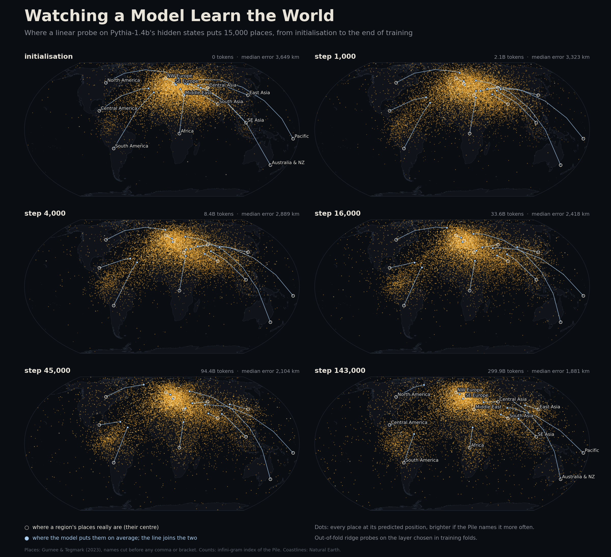
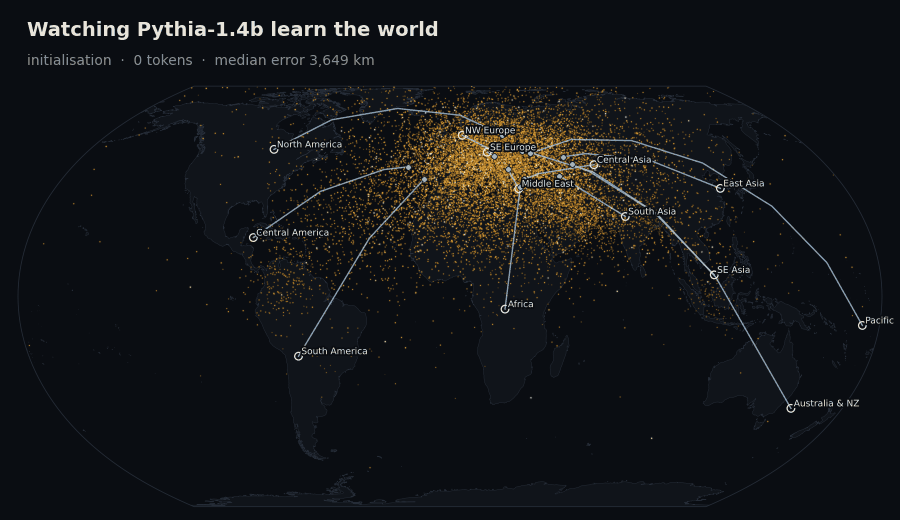
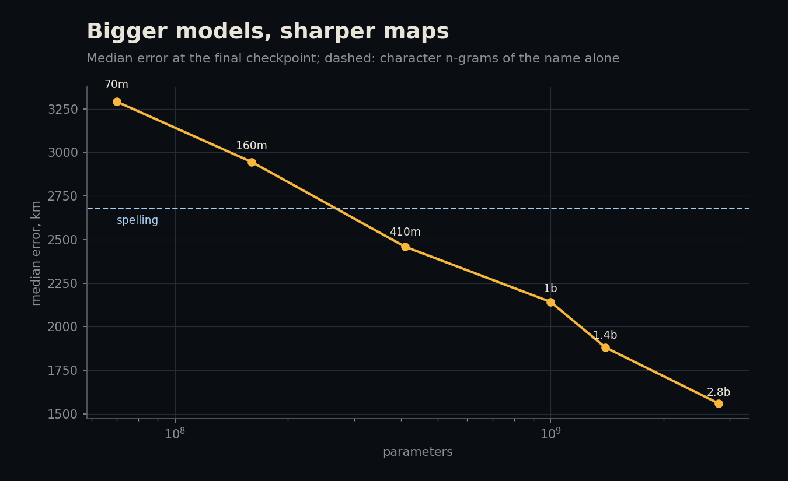
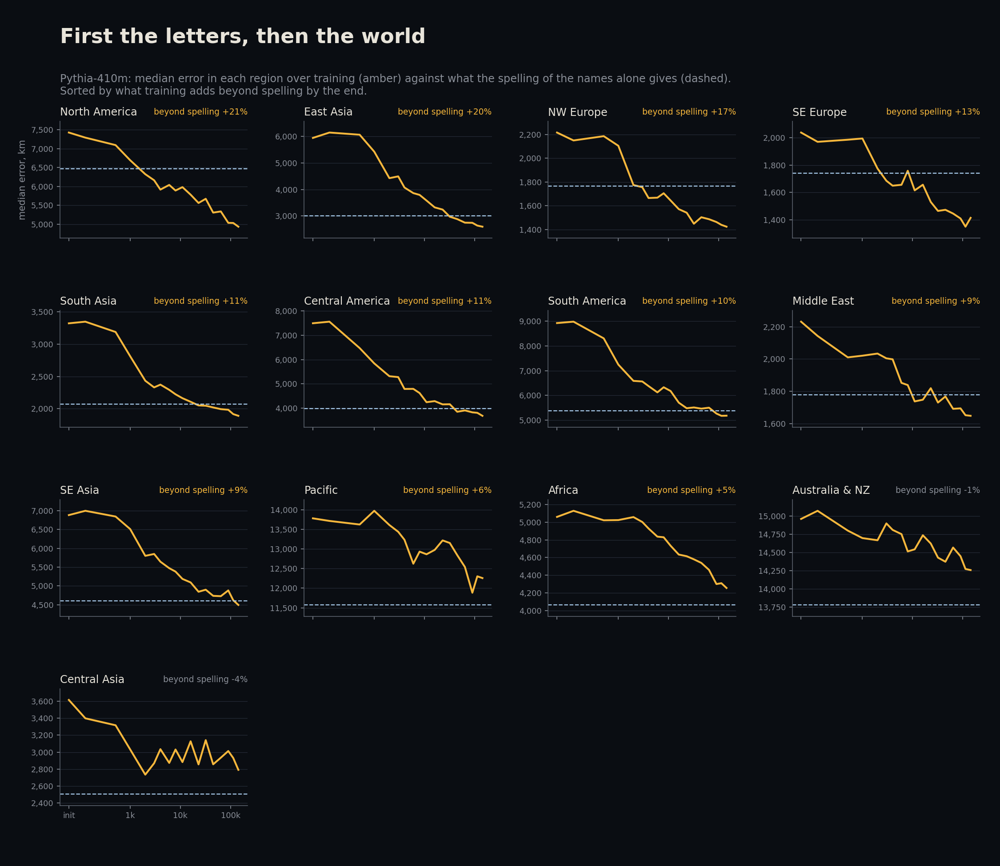
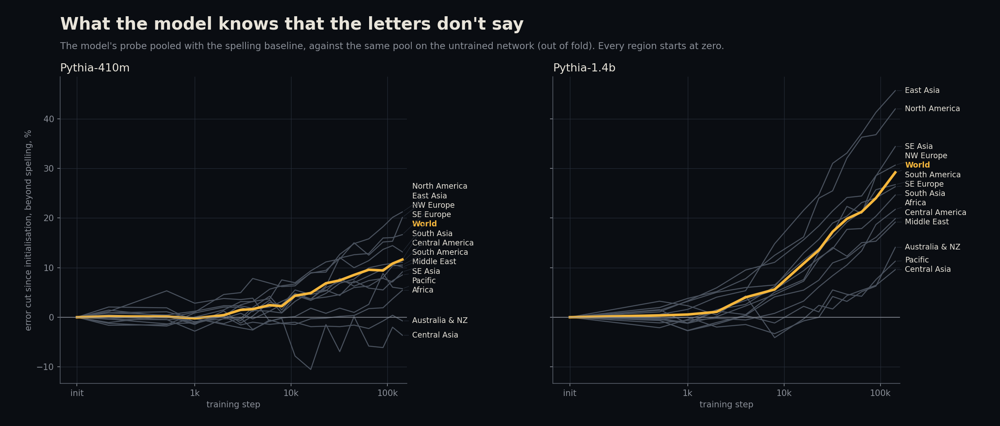
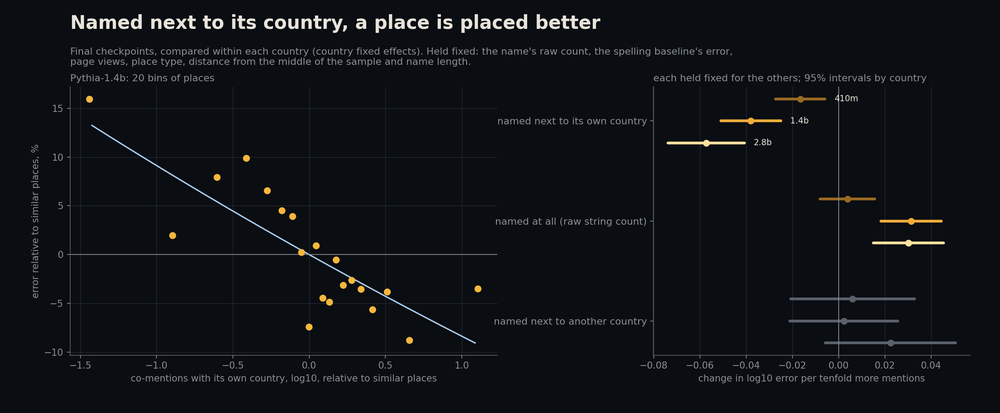
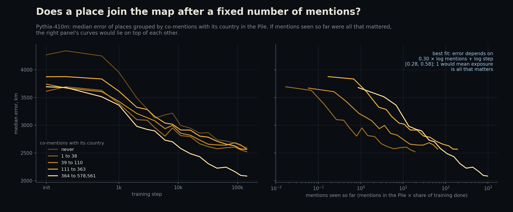

# Watching a Model Learn the World

A language model's hidden states hold a rough map of the world: a linear probe can read a
place's latitude and longitude off them (Gurnee and Tegmark 2023). This project watches
that map form. Pythia models were trained in public, on public data, with checkpoints
saved throughout, so the same probe can be run on the model at initialisation, after a
billion tokens and at the end, and every place's error can be set against how often the
training data mentions it.

15,058 places in 237 countries, six model sizes (Pythia 70m to 2.8b), 18 checkpoints of
Pythia-410m and 13 of Pythia-1.4b, all on a laptop CPU.

**Short answer: the map forms in two phases. The first is the letters; the second is
the world, and it reaches the world unevenly.**

- **First the letters.** For the first 2,000 steps (4 billion tokens) the model learns
  what the spelling of a name already says: "-pur" is South Asian, "-ville" French or
  American, "Kyō-" Japanese. Across 117 countries, how much spelling alone knows about a
  country predicts how much its error falls by step 2,000 (rank correlation 0.69 in both
  models) and not what happens after (0.12 and 0.09).
- **Then the world.** After that the model learns things the letters do not say. By the
  end this cuts error by 12% in Pythia-410m and 29% in Pythia-1.4b, most in East Asia,
  North America and Europe and least in Australia and the Pacific (and, in the smaller
  model, Africa).
- **Australia comes last.** Its town names look English, so the models put most of them
  in Europe. Pythia-410m never learns otherwise. Pythia-1.4b starts to, but only in the
  second half of training, and its median place in Australia and New Zealand is still
  11,700 km out, though Australia is the tenth most-named country in the Pile.
- **The corpus helps where it places a place.** Within a country, places the Pile
  mentions next to that country's name are placed better, more so in bigger models;
  mentions next to a wrong country, and the bare count of the name, predict nothing
  useful. But counts explain little of why whole regions lag. Their names explain more.
- **Not a fixed number of mentions.** A place does not join the map after being read a
  set number of times: ten times the mentions are worth about twice the training, not
  ten times.



An [interactive version](docs/index.html) runs through every checkpoint of both models
and draws any place's path from the middle of the cloud to where the model ends up
putting it.



## What was known, and what is new

Gurnee and Tegmark (2023) found the map in Llama-2 with ridge probes on the hidden state
of each place's name. Godey, de la Clergerie and Sagot (2024) probed Pythia models from
14m to 2.8b at the end of training and found the map worse for Oceania, South Asia and
South America. They also counted country names in a 3.5-million-document sample of the
Pile and found that country error falls, mildly, as mentions rise.

New here: the map at every stage of training; a spelling baseline that the model has to
beat before anything counts as knowledge; exact counts for every place, not just its
country, from the full Pile; and a test of whether a place joins the map once the model
has seen it a fixed number of times.

## Method

**Places.** The world places table of Gurnee and Tegmark: 39,585 Wikipedia places
(towns, regions, buildings, lakes, mountains) with coordinates. Three changes make it
fit for this question.

1. *The title gives the answer away.* "Burgdorf, Switzerland", "Leyburn, Queensland" and
   "San José (canton)" name the place's country or state, and a probe would read it off
   the text. Every name is cut at the first comma or bracket. Names that then collide
   inside the table (two "Delaware County"s) are dropped, since there is no telling which
   one a model would think of.
2. *Country and region come from the coordinates*, using Natural Earth's 1:10m country
   polygons, not the table's own country field (which mixes "England",
   "United_Kingdom" and "Hokkaido").
3. *At most 250 places per country*, chosen at random, so the probe is fit on a world and
   not on the United States, Britain, India and Australia. That leaves 15,767 places.

Names that GeoNames also gives to a town of 1,000 people or more at least 300 km away are
left out of the analysis (4.5%, leaving 15,058): the "Barcelona" in the table is in
Venezuela and its "Liverpool" in Australia, and a model asked about either thinks of the
other one. Leaving out every name Wikipedia had to disambiguate as well (13,223 left)
changes no conclusion below.

**Models.** Pythia (Biderman et al. 2023), six sizes from 70m to 2.8b, all trained on the
Pile in the same order, one pass, 143,000 steps of 2.1 million tokens. Pythia-410m is
read at 18 checkpoints, roughly log-spaced from step 1,000, and Pythia-1.4b at 13.

**Reading the model.** Each place is read as "Where is Burgdorf" (Godey et al.'s
template; the prefix also keeps the name off position 0, which acts as an attention sink).
The hidden state at the name's last token is kept at every layer of the final checkpoint
and at eight depths of the others.

**Probe.** The target is the place's position as a point on the unit sphere, so there is
no seam at the date line and no stretching near the poles. Standardise, ridge regression,
the penalty chosen by exact leave-one-out error on the training folds, and the layer
chosen the same way, inside each training fold. Five folds, assigned within country. A
prediction is turned back into a direction and scored by great-circle distance. Every
place gets one out-of-fold prediction at every checkpoint.

**Spelling baseline.** Names carry their geography in their letters, so a probe can
place many of them with no knowledge of the world at all. The baseline is a ridge
regression from character 1-4 grams of the name onto the same sphere, with the same
folds. The untrained network (step 0) is a second floor: random embeddings still tell
tokens apart, so a probe on them learns some spelling too.

**Beyond spelling.** At each checkpoint the probe's predictions and the spelling
baseline's are pooled by a linear map (six inputs, three outputs) fit on the other
folds. The gain is how much lower the pool's median error is than the same pool built on
the untrained network. Every region starts at exactly zero, and anything above zero is
something training put into the model that the letters do not say.

**Corpus counts.** The [infini-gram](https://infini-gram.io) index of the Pile's training
split counts, exactly, for each name: how often it occurs, how often it occurs within 50
tokens of its own country's name ("Burgdorf" ... "Switzerland"), and, for 6,000 places,
how often it occurs within 50 tokens of another place's country. Placebo countries are a
shuffle of the real ones, so they are as big and as often named.

**Exposure.** Pythia sees the Pile once, in a fixed shuffled order, so by step t the
model has seen about count x t / 143,000 of a name's mentions. If a place joined the map
after a fixed number of mentions, error would depend on count and step only through their
product. The test fits log error = f(alpha log count + log step), with f a step function
on 40 bins: alpha = 1 means exposure is all that matters, alpha = 0 means the count does
not matter at all.

**Checks.** Unit tests plant a map in random states and require the probe to find it
within 300 km, require it to find nothing in noise, require the spelling model to learn
planted suffixes, and require the fast ridge used here to match scikit-learn's RidgeCV
exactly. On Godey et al.'s own setup (full titles, their split, latitude and longitude
R squared) Pythia-160m scores 56.5 here against their 55.3, and Pythia-1b 68.6 against
their 67.9.

## Results

### 1. Bigger models, sharper maps

| | spelling | 70m | 160m | 410m | 1b | 1.4b | 2.8b |
|---|---|---|---|---|---|---|---|
| median error, km | 2,681 | 3,291 | 2,945 | 2,459 | 2,142 | 1,881 | 1,560 |

Guessing the middle of the sample for every place is off by 4,623 km. Spelling alone gets
2,681 km, and the two smallest models do worse than that: their hidden states hold the
letters less usefully than the letters themselves. From 410m up every size beats it.



### 2. First the letters, then the world

Pythia-410m's median error falls from 3,797 km at initialisation to 2,459 km at the end,
and half of that fall is done by step 3,000 (6 billion tokens, 2% of training).
Pythia-1.4b goes from 3,649 km to 1,881 km and keeps improving for longer: half its fall
is done by step 6,400. In both, the regions do not move together. The step by which each
region has made half its eventual improvement (95% intervals from resampling places):

| region | Pythia-410m | Pythia-1.4b | end of training, 410m / 1.4b |
|---|---|---|---|
| South America | 1,225 [966, 1,542] | 1,812 [989, 3,648] | 5,186 / 3,933 km |
| Central America & Caribbean | 1,393 [999, 2,455] | 1,653 [974, 2,580] | 3,678 / 3,010 km |
| South Asia | 1,458 [1,198, 1,831] | 2,534 [1,558, 4,438] | 1,889 / 1,546 km |
| Northern & Western Europe | 1,817 [1,631, 2,321] | 3,587 [2,620, 5,063] | 1,424 / 1,189 km |
| East Asia | 3,495 [1,995, 3,966] | 3,028 [2,374, 4,424] | 2,597 / 1,556 km |
| Southern & Eastern Europe | 2,494 [1,918, 3,445] | 8,226 [5,318, 10,387] | 1,414 / 1,197 km |
| Southeast Asia | 3,758 [1,745, 5,688] | 11,645 [7,972, 17,620] | 4,495 / 2,923 km |
| North America | 2,871 [1,659, 4,380] | 12,532 [6,690, 17,870] | 4,931 / 3,477 km |
| Sub-Saharan Africa | 14,621 [9,917, 30,050] | 21,342 [16,991, 27,207] | 4,257 / 3,322 km |
| Australia & New Zealand | barely moves | 74,879 [30,859, 99,058] | 14,259 / 11,689 km |

Latin America and South Asia come first in both models; Africa and Australia last.
The early regions are the ones whose names carry their language. Spanish and Portuguese
names, Indian names and Japanese names are easy for the spelling baseline too. The test
is across countries. For each of the 117 countries with 30 or more places, take how far
below the untrained network's error the spelling baseline gets (what the letters can
say about that country), and the share of the untrained error the model removes before
and after step 2,000.

| rank correlation with what spelling knows | Pythia-410m | Pythia-1.4b |
|---|---|---|
| error removed by step 2,000 | 0.69 (p 5e-18) | 0.69 (p 5e-18) |
| the same, starting error partialled out | 0.70 | 0.67 |
| error removed after step 2,000 | 0.12 (p 0.19) | 0.09 (p 0.33) |
| the same, starting error partialled out | 0.17 (p 0.07) | 0.06 (p 0.52) |

The partial correlation is there because both shares divide by the starting error; it
does not drive the link. Over the 13 regions the early correlations are 0.81 and 0.88.

So early training teaches the model what a probe could have learned from the letters.
The panels below show it region by region: the model's error (amber) falls towards the
spelling floor (dashed) in the first few thousand steps, and only some regions go below it.



What the model knows beyond the letters is measured directly by pooling its probe with
the spelling baseline. For the world it is zero until step 2,000 and climbs after: to an
11.6% cut in error by the end in Pythia-410m [10.4, 12.9], and 29.2% in Pythia-1.4b
[27.6, 30.3], still rising steeply when training stops. By region, at the end:

| region | Pythia-410m | Pythia-1.4b |
|---|---|---|
| East Asia | 20.1% [14.8, 23.5] | 45.7% [42.5, 48.6] |
| North America | 21.2% [17.6, 23.8] | 42.0% [37.7, 45.5] |
| Southeast Asia | 8.5% [4.9, 13.7] | 34.4% [30.6, 39.2] |
| Northern & Western Europe | 16.7% [13.5, 19.1] | 30.7% [28.0, 33.2] |
| South America | 10.1% [6.6, 14.5] | 26.7% [22.7, 30.4] |
| Southern & Eastern Europe | 13.2% [10.6, 16.3] | 26.3% [23.3, 28.7] |
| South Asia | 11.1% [6.3, 14.3] | 24.6% [20.7, 29.0] |
| Sub-Saharan Africa | 5.4% [3.2, 7.9] | 21.7% [19.5, 24.6] |
| Central America & Caribbean | 10.5% [5.9, 14.5] | 19.9% [14.7, 24.8] |
| Middle East & North Africa | 9.1% [5.1, 12.7] | 19.2% [15.5, 23.1] |
| Australia & New Zealand | -0.7% [-4.9, 1.7] | 14.1% [8.5, 19.7] |
| Pacific Islands | 5.8% [0.0, 11.3] | 11.3% [3.7, 20.6] |



The order flips between the two phases. Latin America and South Asia improve first, on
their letters; what the model learns beyond the letters goes first to East Asia, North
America and Europe. The bigger model learns more about everywhere, and starts on the
regions the smaller one never reaches, but Australia and the Pacific stay at the bottom.
Africa, down with them in Pythia-410m (5%), moves past Central America and the Middle
East in Pythia-1.4b (22%).

### 3. Where the model learns, and where it never does

Country by country, the gain beyond spelling rises with how often the Pile names the
country, but loosely: rank correlation 0.28 (p 0.003) in Pythia-410m and 0.25 (p 0.006)
in Pythia-1.4b, over the 117 countries with 30 or more places. The exceptions are more
telling than the trend.

- **Australia** is named 9.1 million times in the Pile, more than any country but nine.
  Pythia-410m gains nothing there (-3%) and Pythia-1.4b little (+10%). Its town names are
  English: Woolbrook, Tennant Creek, Blairgowrie. The letters say Europe, and
  Pythia-410m's average guess for an Australian place stays in central Europe (47°N
  16°E). Pythia-1.4b's has only moved as far as the Caspian (47°N 54°E).
- **Spain** loses ground in Pythia-410m (-23%). Its average guess for a Spanish town sits
  in the mid-Atlantic (32°N 30°W), further west than spelling puts it (18°W): the pull
  of Spanish names in the Americas. Peru (-14%) is pulled the other way. The bigger
  model mostly gets past this: Spain -4%, Peru +34%, New Zealand +37%.
- The largest gains go to **Taiwan**, **Japan**, **Vietnam** and **Thailand** (+52% to
  +61% in Pythia-1.4b): names that look like their country, in countries the Pile writes
  about.

So a country does not get onto the map just by being written about. Its places need
names that are not already claimed by somewhere better known, or a model big enough to
learn past the claim.

### 4. Does the corpus explain it?

**Countries.** Across countries, the more often the Pile names a country, the better
its places are placed, as Godey et al. found: error falls by 0.14 to 0.16 log10 km per
tenfold more mentions (r -0.28 to -0.32), for every size.

**Places, within a country.** The sharper test compares places inside one country, so
that nothing about the country (where it is, how big, how written about) can matter.
Every slope below comes from one regression with country fixed effects and the place's
type, Wikipedia page views, distance from the middle of the sample, name length in
tokens and the spelling baseline's own error held fixed; intervals are clustered by
country.

| change in log10 error per tenfold more | 410m | 1.4b | 2.8b |
|---|---|---|---|
| mentions next to its own country | -0.017 [-0.027, -0.006] | -0.038 [-0.051, -0.025] | -0.057 [-0.074, -0.041] |
| mentions of the name at all | +0.004 [-0.008, +0.016] | +0.031 [+0.018, +0.045] | +0.030 [+0.015, +0.046] |
| mentions next to another country (placebo, 5,716 places) | +0.006 [-0.021, +0.033] | +0.002 [-0.021, +0.026] | +0.023 [-0.006, +0.051] |

- **What matters is the corpus placing the place.** Mentions of the name within 50
  tokens of its own country predict a better placing, and the slope grows with model
  size. Mentions next to a randomly assigned country predict nothing, so this is not
  names that sit near country names in general.
- **The bare count does not help, and given the co-mentions it hurts.** A name the Pile
  uses often but rarely next to its country is mostly something else: a person, a word,
  another town. Alone, the raw count is no help: +0.001, +0.015 and +0.002, and the one
  slope that is not zero (1.4b, p 0.03) points the wrong way.
- **It is learned, not just easy.** The spelling term holds fixed what the letters give.
  The same holds for what training changed: from initialisation to the end, places with
  ten times the co-mentions improve by a further 0.012 log10 (410m, p 0.02) and 0.035
  (1.4b, p 4e-8).
- **The rare names show it most.** Among the 2,864 places whose counts are exact (the
  engine subsamples above 500,000 matches), the co-mention slope is 1.5 to 1.7 times as
  steep: -0.046, -0.081 and -0.097, against -0.027, -0.048 and -0.067 for all places in
  the same regression (without the spelling term).



**Regions.** How much of each region's extra error does any of this account for? The
region gaps below are in log10 error relative to north-western Europe, for Pythia-1.4b,
with distance from the middle of the sample and place type held fixed. Then the spelling
baseline's error is added, then every corpus term (the place's mentions, its co-mentions,
its country's mentions, page views, name length).

| region | gap | with spelling held fixed | then with the corpus held fixed |
|---|---|---|---|
| Pacific Islands | 0.54 | 0.33 | 0.28 |
| Australia & New Zealand | 0.50 | 0.27 | 0.25 |
| Sub-Saharan Africa | 0.24 | 0.16 | 0.14 |
| South America | 0.23 | 0.14 | 0.13 |
| North America | 0.22 | 0.09 | 0.09 |
| Central Asia | 0.17 | 0.14 | 0.11 |
| Central America & Caribbean | 0.16 | 0.11 | 0.09 |
| Southern & Eastern Europe | 0.14 | 0.09 | 0.10 |
| Southeast Asia | 0.11 | 0.05 | 0.06 |
| Middle East & North Africa | 0.10 | 0.09 | 0.10 |

Spelling accounts for a third to two thirds of the gap in eight of the ten regions (the
exceptions are Central Asia, 19%, and the Middle East, 9%); the corpus terms, added
after it, for at most a fifth more. The regions the model maps worst are, first of all,
regions whose names say the wrong thing.

### 5. Does a place join the map after a fixed number of mentions?

Pythia reads the Pile once, in a fixed order, so by step t it has seen about a fraction
t / 143,000 of each name's mentions. If a place joined the map once the model had read
about it a fixed number of times, error would depend on mentions and step only through
their product, and the curves for often and rarely named places would lie on top of
each other when drawn against mentions seen so far. They do not.

| what is counted | alpha, Pythia-410m | alpha, Pythia-1.4b |
|---|---|---|
| mentions of the name | 0.03 [0.00, 0.03] | 0.00 [0.00, 0.03] |
| mentions next to its own country | 0.30 [0.28, 0.58] | 0.33 [0.28, 0.38] |
| mentions of its country (237 countries) | 0.60 [0.11, 1.98] | 0.58 [0.03, 1.86] |

Alpha is how many decades of training a decade of mentions is worth: 1 would mean only
mentions seen matter. For co-mentions it is 0.30 and 0.33, the same in both models. A
place the Pile names next to its country ten times as often behaves like one trained
twice as long, not ten times as long. Country mentions are worth more, but with 237
countries the interval spans almost everything.

Most of what moves a place onto the map is training as a whole: the model's sense of
geography grows for every place at once, and a place's own mentions shift it only a
little. In the figure only the top quarter of places named next to their country (364
co-mentions or more) pulls clearly ahead; the other groups move together.



## Caveats

- **A probe measures what is linearly readable,** not everything a model knows. A model
  that stores a place's country but not as a direction in its hidden state scores badly
  here. Gurnee and Tegmark found nonlinear probes no better, but that was Llama-2.
- **Ridge probes shrink towards the middle.** A place the model knows little about is
  predicted near the centre of the sample, which lies near Europe. That makes distant
  regions look worse than close ones for the same ignorance. Comparisons across regions
  therefore use either each region's own start and end (arrival), the pooled gain over
  the same pool at initialisation (beyond spelling), or regressions with the distance
  from the middle held fixed.
- **One template for the series.** Every checkpoint reads "Where is X". As a check, the
  final Pythia-410m was also read with the bare name after an end-of-text token: it does
  a little better (2,314 km against 2,459; 14.5% beyond spelling against 11.6%) with the
  same regional pattern (Australia 0% and Africa 2% beyond spelling, north-western Europe
  23%, East Asia 23%, North America 23%; rank correlation of the regional gains between
  the two templates 0.94).
- **Counts are of strings.** The Pile count of "Tyre" counts car tyres, and "Victoria" a
  queen and a dozen towns. The co-mention counts (the name within 50 tokens of its
  country) are the cleaner measure of how often the corpus places a place, and names
  GeoNames gives to a second town are left out.
- **Exposure assumes an even data order.** Pythia's shuffled order is fixed but its
  per-step contents were not counted here; mentions seen by step t are taken as
  count x t / 143,000.
- **Regions are wide.** "Sub-Saharan Africa" holds 50 countries and the Pacific 20, and
  the country-level tables have only the 117 countries with 30 or more places.

## Reproduce

CPU only, Python 3.13, 8 threads. About 40 GB of disk for checkpoints in the Hugging Face
cache (the 1.4b ones are deleted after use) and 18 GB for hidden states. The full run is
about 20 hours of extraction and 12 hours of counting, which can overlap.

```bash
pip install -r requirements.txt
cd src
python places.py          # the place sample, folds, countries and regions
python homonyms.py        # names shared with another town; word-like names
python counts.py          # infini-gram counts (about 12 hours at the API's rate limit)
python probe.py --spell   # the spelling baseline
cd .. && bash run_track.sh && bash run_after.sh    # hidden states, every size and step,
                          # the template check and the replication titles
bash run_probes.sh        # probes every states file (runs beside the extraction)
cd src
python analysis.py        # every table in results/
python figures.py --size 1.4b && python figures.py --only regions,beyond,exposure
python webmap.py          # docs/data.js for the interactive map
python report.py          # the numbers quoted here
```

Tests: `python -m pytest`.

## Files

| file | what it does |
|---|---|
| `src/config.py` | paths, models, checkpoints, template, regions |
| `src/places.py` | the place sample: cut names, countries from coordinates, cap, folds |
| `src/homonyms.py` | names GeoNames gives to another town 300 km away; word-like names |
| `src/extract.py` | hidden states for one size and step |
| `src/prefetch.py` | downloads checkpoints ahead of the extraction |
| `src/probe.py` | ridge probes onto the sphere, the spelling baseline, the replication |
| `src/counts.py` | infini-gram counts, co-mentions and placebo co-mentions |
| `src/analysis.py` | formation, beyond spelling, counts, gaps, exposure |
| `src/figures.py` | the figures and the animation |
| `src/webmap.py` | data for the interactive map in `docs/` |
| `src/report.py` | prints every number in this README |
| `tests/test_core.py` | known-answer tests |

Data are not in the repository: the place table comes from the
[world-models](https://github.com/wesg52/world-models) repository, coordinates of
countries from Natural Earth, homonyms from GeoNames, counts from infini-gram, and
models from the Hugging Face Hub. All scripts fetch what they need.
